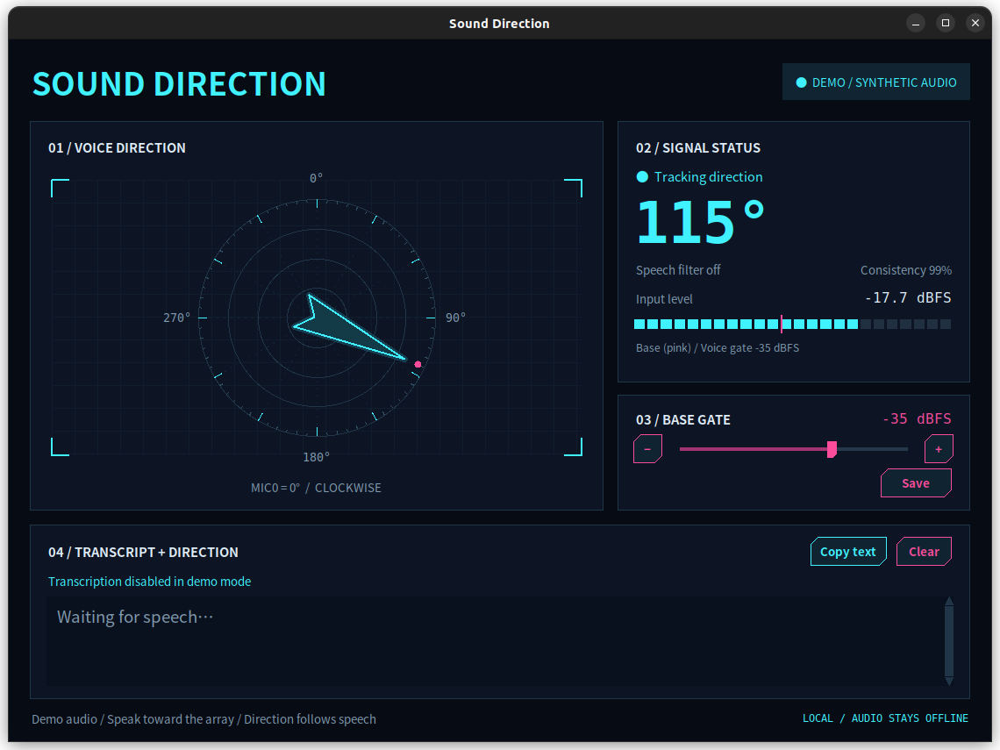

[简体中文](README.zh-CN.md)

# Sound Direction

This project is a voice-direction and offline speech-transcription application for **Quectel PI M2**, the Sipeed 6+1 microphone array, and the MA-USB8 board.

The interface uses English labels. Recognition language defaults to `auto`: Chinese speech produces Chinese text, while English speech produces English text. A typical result is `[Direction 060°] Hello`; when direction evidence is insufficient, the result uses `[Direction unknown]`.

The cyberpunk-style interface shows a direction radar on the left, angle, speech state, level, and gate information on the right, and offline transcripts at the bottom. A cyan arrow points toward the source only when voice detection, adaptive speech-band level, and direction consistency all pass. The radar displays an idle reticle when no valid source is present.

The Quectel PI M2 version provides voice direction and speech-to-text together in a compact interface. Recognition runs in a separate background thread so localization can continue without waiting for inference. Audio is processed locally and is not uploaded.

Each transcript uses direction evidence collected while that sentence was spoken. The application computes a circular mean weighted by consistency and audio duration; it does not use the direction at recognition completion or the visually smoothed arrow angle. Pre-roll audio and trailing silence do not contribute direction evidence, and each part of a long utterance is evaluated independently.

By default, a transcript direction requires at least 120 ms of valid evidence, coverage of at least 20% of voiced duration, and direction concentration of at least 0.6. When evidence is missing or conflicting, transcription continues and the direction is reported as unknown.



## Start

From a terminal in the Quectel PI M2 graphical desktop, enter the project directory and run:

```bash
cd /path/to/demo-sound-localization
bash run.sh
```

Replace `/path/to` with the actual parent directory of the project on the board.

The default runtime uses WebRTC VAD voting across three spaced raw microphones. At least two channels must report speech before voice is confirmed. Playback speech can also trigger VAD, and music or noise may still cause false positives. The last valid direction is held for approximately 0.55 seconds after speech ends.

Speech recognition uses the SenseVoice INT8 model stored locally on Quectel PI M2 and detects the language of each segment automatically. Set `asr_language` to `zh` or `en` to select a fixed language, then restart the application.

The segmenter retains 300 ms of pre-roll audio, waits 800 ms for trailing silence, and limits each segment to 15 seconds. Text segmentation is independent of the display gate so quieter words are less likely to be omitted, although recognition errors remain possible.

Additional commands:

```bash
bash run.sh --probe --seconds 5   # Headless live-capture diagnostics
bash run.sh --wav recording.wav  # Replay 8-channel, 48 kHz, 16-bit PCM WAV
bash run.sh --demo               # Clearly labeled synthetic direction demo; VAD is disabled
bash test.sh                     # Localization, VAD, segmentation, and offline ASR tests
```

## Adjust the Gate

Keep the environment quiet and observe the input level, then speak at a normal volume. Set the gate above most ambient sound and below normal speech. For example, if the quiet level is -45 dBFS and speech is -32 dBFS, begin around -39 to -37 dBFS.

A more negative value, such as -40, is easier to trigger. A value closer to zero, such as -30, is harder to trigger. The pink marker on the level meter shows the current base gate. Click **Save** to persist it across restarts.

The saved value is the **base gate**. After speech is confirmed, the application can use a more permissive speech-band gate based on the learned background-noise spectrum. The interface displays the effective gate as well. Transcript directions do not depend on whether the smoothed display arrow passes the base gate.

Keep the environment quiet for the first two to three seconds so the application can learn the stable noise spectrum. The noise model is updated only when speech is not detected, and stable fan or hum frequencies are downweighted during localization.

A large direction jump requires three consecutive similar results before the arrow moves. This reduces rotations caused by short interference, but a real speaker change may add roughly one hundred milliseconds of confirmation delay. The system does not separate simultaneous speakers; strong noise, multiple sources, and reverberation can still affect the result.

The analyzed speech band is 250–4000 Hz. `speech_floor_dbfs` defaults to -58 dBFS, and `speech_snr_db` defaults to 2 dB. These values apply to the processed speech band rather than the full-band input level. Restart the application after changing them.

## Configuration

Advanced settings are stored in `config/config.json` and take effect after restart.

| Key | Purpose |
| --- | --- |
| `device` | ALSA device; defaults to `hw:MicArray,0` |
| `mic_channels` | Six clockwise raw microphone channels; defaults to CH0–CH5 |
| `radius_m` | Outer microphone radius; currently 0.04 m |
| `gate_dbfs` | Base gate; may be relaxed automatically after speech is confirmed |
| `min_confidence` | Direction-consistency threshold; defaults to 0.2 and is a heuristic score, not an accuracy probability |
| `vad_mode` | Voice-filter aggressiveness from 0 to 3; defaults to 2, with higher values being stricter |
| `vad_channel` | Raw channel used as the starting VAD channel; defaults to CH0 |
| `angle_offset_deg` | Global rotation applied to displayed directions |
| `mirror` | Mirrors displayed directions |
| `hold_seconds` | Time to hold the direction after speech ends |

## Software and Hardware Principles

Quectel PI M2 captures eight-channel USB audio through ALSA and `arecord`. Localization uses CH0–CH5 with GCC-PHAT/SRP and processes blocks of 2048 samples, approximately 42.7 ms each. CH6 is the board-provided beamformed output and is not treated as an independent microphone for localization.

WebRTC VAD analyzes continuous 20 ms frames from raw channels and carries incomplete frame data across capture blocks. The direction result is smoothed circularly and drawn by Tk Canvas. The application estimates horizontal direction only; it does not estimate distance.

- `src/sound_localization/`: application, audio capture, localization, speech, ASR, and UI modules.
- `tests/`: unit and optional integration tests.
- `tools/transcribe.py`: standalone WAV transcription and real-model validation entry point.
- `tools/setup_asr.py`: model download and installation entry point.
- `config/config.json`: runtime configuration.
- `requirements/`: optional VAD and ASR dependency lists.
- `scripts/env.sh`: shared runtime environment; `run.sh` and `test.sh` remain the stable launchers.

## Prepare Quectel PI M2

The recorded board environment is aarch64 with Debian 13. For a first deployment, run the following commands from the project directory to install system components, create the virtual environment, install Python dependencies, prepare the SenseVoice model, and start the application:

```bash
sudo apt install python3 python3-venv python3-numpy python3-tk alsa-utils fonts-noto-cjk
python3 -m venv --system-site-packages .venv
.venv/bin/python -m pip install -r requirements/asr.txt
python3 tools/setup_asr.py
bash run.sh
```

For device problems, run `arecord -l`. To find processes using sound devices, run `fuser /dev/snd/*`. An SSH login alone does not create a graphical desktop session, so use `--probe` for headless board diagnostics.

## Offline Recording Validation and Recognition Parameters

Use the same recording repeatedly to compare recognition behavior without recapturing audio:

```bash
.venv/bin/python tools/transcribe.py --file models/sherpa-onnx-sense-voice-zh-en-ja-ko-yue-int8-2024-07-17/test_wavs/zh.wav
.venv/bin/python tools/transcribe.py --file your_recording.wav --channel 0 --segment
```

This entry point accepts mono or multichannel, uncompressed 16-bit PCM WAV files. `--channel` selects a zero-based channel. Files longer than 30 seconds require `--segment`; segmentation supports 8, 16, 32, and 48 kHz. A mono WAV has no array geometry, so standalone file transcription does not calculate sound direction.

| Key | Default | Purpose |
| --- | --- | --- |
| `asr_language` | `auto` | Detect the language automatically; may be fixed to `zh` or `en` |
| `asr_channel` | `0` | Audio channel used for transcription |
| `asr_threads` | `2` | CPU threads used by the model |
| `asr_pre_roll_seconds` | `0.3` | Audio retained before speech begins |
| `asr_silence_seconds` | `0.8` | Trailing silence that ends an utterance |
| `asr_min_speech_seconds` | `0.24` | Discards very short triggered segments |
| `asr_max_seconds` | `15` | Maximum duration of each recognition segment |

The background queue accepts at most two waiting utterances. When it is full, new segments are skipped rather than blocking capture. Normal operation does not write live recordings or transcripts to disk.

The model and token file are stored under `models/`, and Python runtime dependencies are stored under `.venv/`. Do not treat these runtime assets as disposable cache after installation.

Reference: [Sipeed MA-USB8 documentation](https://wiki.sipeed.com/hardware/en/modules/micarray_usbboard_bl616.html).

## Technical support and contributions

If you encounter any problems during use, please submit a technical inquiry on the [Quectel official forum](https://forums.quectel.com/c/quectel-pi/80). The Quectel technical support team will respond promptly.
