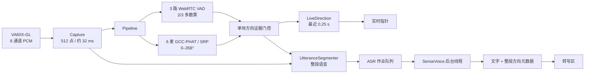
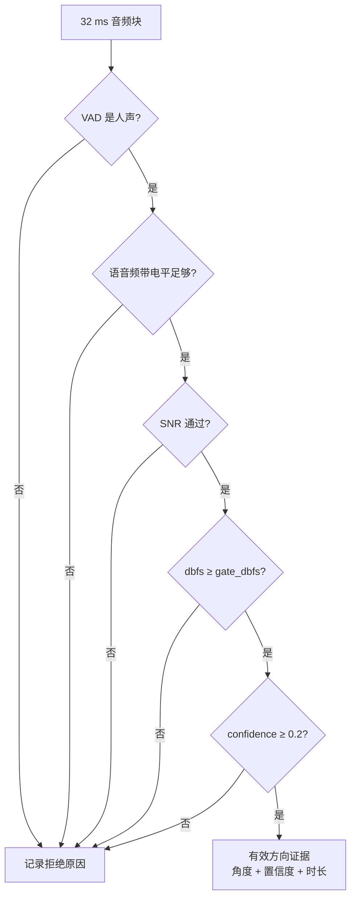
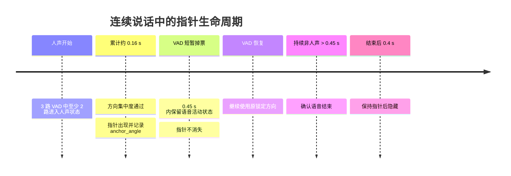
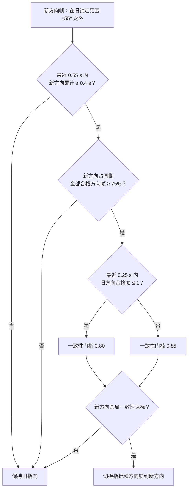
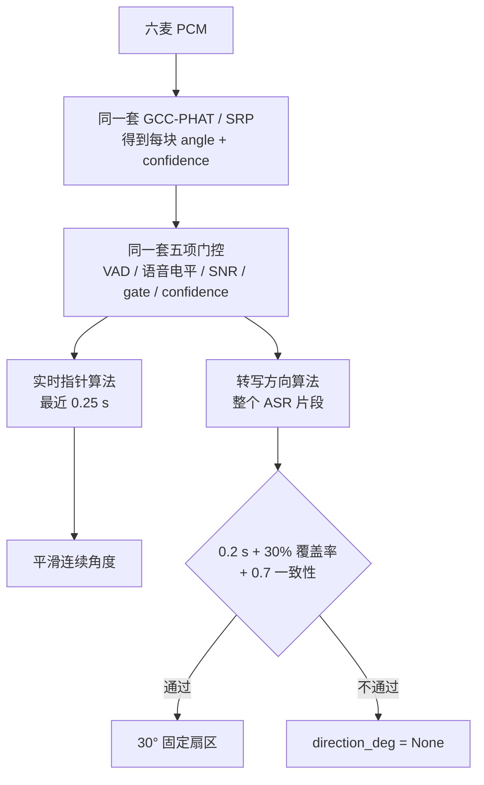

# Sound Direction 架构设计

本文描述当前 VA60X-GL 版本的运行架构、数据流、方向判定和异常恢复。用户安装与调参参见 [README.md](../README.md)，后续优化参见 [next-version-plan.md](next-version-plan.md)，开源发布和贡献约束参见 [opensource.md](opensource.md)。

> 文档状态：2026-10-28，与当前工作区代码及 `config.json` 同步。

## 1. 目标与边界

系统运行在 Quectel PI M2，输入为 VA60X-GL 的八通道 USB PCM，分别输出实时人声方向和分段离线转写。

设计目标：

- 声卡号改变后仍可自动识别同一 USB 设备；
- 采集、定位与 ASR 解耦，模型加载或推理不能阻塞录音；
- 只有确认的人声和足够稳定的定位证据才能驱动指针；
- 指针由实时定位结果更新，转写独立保留该段的方向；
- 缺少方向证据不影响文字转写；
- 所有音频、方向和文本默认只在本机内存处理。

非目标：

- 不估计声源距离或俯仰角；
- 不分离多个同时说话的人；
- 不把启发式 `confidence` 解释为定位正确率；
- 当前不自动循环重连，用户需要点击“重新检测设备”；
- 当前几何参数不是对每一块实物的出厂标定值。

## 2. 系统上下文

当前实现有两个彼此独立的方向结果：

- **实时指针方向**：由 `LiveDirection` 在采集线程内立即计算，不等待 ASR。
- **转写条目方向**：由 `UtteranceSegmenter` 累计整段语音的证据，语句结束后随 ASR 文字返回。



Tk 组件只在主线程更新。工作线程产生短时采集结果；ASR 线程产生语句级结果。两个生产者均通过有界队列与界面解耦，避免慢消费者无限占用内存。

## 3. 硬件输入契约

### 3.1 PCM 格式

| 项目 | 当前值 |
| --- | --- |
| USB VID:PID | `0bda:4cf0` |
| ALSA 配置 | `device: auto` |
| 格式 | `S16_LE` |
| 采样率 | 16,000 Hz |
| 通道数 | 8 |
| 定位块长 | 每通道 512 点，约 32 ms |

`audio.resolve_device()` 遍历 `/sys/class/sound/card*` 的 USB 父节点，根据 VID:PID 找到唯一声卡，再生成 `hw:<card>,0`。找不到或找到多个同标识设备都会显式报错，避免打开错误音源。

`Capture` 通过 `arecord -q -t raw` 获取交错 PCM。读取等待使用 200 ms `select`，连续 4 秒无数据视为超时。关闭时由拥有采集对象的工作线程终止子进程并回收句柄。

### 3.2 通道重排

| 环形顺序 | 物理麦克风 | 硬件通道（1 起始） | 数组索引（0 起始） |
| ---: | --- | ---: | ---: |
| 0 | MIC_1 | 1 | 0 |
| 1 | MIC_2 | 5 | 4 |
| 2 | MIC_4 | 6 | 5 |
| 3 | MIC_5 | 2 | 1 |
| 4 | MIC_6 | 3 | 2 |
| 5 | MIC_8 | 4 | 3 |

硬件通道 7（索引 6）为空，通道 8（索引 7）为回采。采集仍保留八通道，但定位只按 `mic_channels: [0,4,5,1,2,3]` 提取六路。

### 3.3 几何坐标

六麦使用等间隔圆环模型，角度为 `0, 60, …, 300°`，半径暂设 0.035 m，声速取 343 m/s。模型约定 MIC_1 径向为 0°，后续麦克风按顺时针排列。

这是必须现场验证的假设：

- `angle_offset_deg` 校正软件 0° 与设备正前方的差值；
- `mirror` 校正物理顺序与软件角度增大方向相反的情况；
- 获得精确坐标后应更新 `radius_m`，必要时把等间隔模型替换为显式坐标表。

## 4. 运行组件

| 组件 | 职责 | 执行位置 |
| --- | --- | --- |
| `app.py` | 参数解析、生命周期、状态协调、设备重检 | Tk 主线程 + 采集工作线程 |
| `sound_direction/audio.py` | USB 声卡解析、`arecord`、WAV 输入 | 采集工作线程 |
| `sound_direction/localization.py` | SRP 扫描、噪声频谱抑制、实时跟踪 | 采集工作线程 |
| `sound_direction/live_direction.py` | 短时人声方向稳定、跳变确认和短时保持 | 采集工作线程 |
| `sound_direction/speech.py` | 三路 WebRTC VAD 与方向证据门控 | 采集工作线程 |
| `sound_direction/asr.py` | 分句、方向汇总、SenseVoice、识别队列 | 采集线程 + ASR 线程 |
| `sound_direction/neon_ui.py` | 雷达、扇区、电平、按钮和文本区 | Tk 主线程 |
| `sound_direction/i18n.py` | 中英文界面字符串 | Tk 主线程 |
| `transcribe.py` | 独立 WAV 转写验证 | 命令行进程 |

### 4.1 队列与背压

- 采集结果队列容量为 2；满时丢弃最旧结果并保留最新状态，界面不需要重放每个 32 ms 块。
- ASR 作业队列容量为 2；满时跳过新语句，以持续采集优先。
- ASR 事件队列容量为 64，传递加载、排队、结果、繁忙和错误状态。
- UI 只保留最近 20 条转写。

`run_id` 标识当前采集代次。设备重检后，旧线程迟到的消息因代次不匹配被丢弃，防止旧设备状态覆盖新会话。

## 5. 帧级处理

### 5.1 VAD

每个 `SpeechDetector` 从单个原始麦克风取 20 ms 帧交给 WebRTC VAD，不对延时不同的麦克风做平均，以免相消。跨 512 点采集块的剩余字节保存在内部缓冲。

从环形序列中每隔两个位置选一路，默认得到软件通道 0、5、2，即 MIC_1、MIC_4、MIC_6。至少两路报告人声才判定为 `speech = true`。

- 连续 2 个正帧进入人声状态；
- 连续 8 个负帧退出人声状态；
- `vad_mode` 范围 0–3，当前配置为 2，越大越严格。

VAD 判断“像不像人声”，不判断是否为现场目标人员。扬声器播放的人声也可能通过。

### 5.2 噪声模型和语音频段质量

只有明确非人声的块才更新噪声功率谱，指数更新系数为 0.04。累计至少 3 个噪声块后，稳定的风扇声或嗡声频点在定位时被降低权重。

分析频带固定为 250–4000 Hz。默认质量条件为：

- `analysis_dbfs >= speech_floor_dbfs`，缺省回退值为 -58 dBFS；
- 噪声模型已校准时，`snr_db >= 0`；未校准时不因 SNR 拒绝。

自适应显示门限为 `max(speech_floor_dbfs, noise_dbfs + speech_snr_db)`，再与基础门限取较宽松者。它影响实时活动显示，但不会取代语句方向的基础硬门限。

### 5.3 GCC-PHAT / SRP

定位步骤：

1. 按 `mic_channels` 提取六路，归一化并去直流；
2. 使用 Hann 窗，512 点输入做 1024 点实数 FFT；
3. 对 15 个麦克风对计算 PHAT 归一化互功率谱；
4. 对 0–358°、步长 2° 的每个候选角，根据圆环几何计算理论到达时差；
5. 在线性插值的相关函数中取相应延时值，对各麦克风对归一化后累加；
6. 最大分数的角度为原始方向，再应用 `mirror` 与 `angle_offset_deg`。

`confidence` 综合所有麦克风对在峰值方向的相干程度和相关峰锐度，并裁剪到 0–1。它是筛选用启发式分数，不是概率。`direction_valid` 要求 `confidence >= min_confidence`，默认 0.2。

## 6. 共用的单块方向证据

### 6.1 五项门控

一个块只有同时满足以下条件才设置 `sentence_direction_valid = true`：

```text
speech
AND analysis_dbfs >= speech_floor_dbfs
AND (噪声未校准 OR snr_db >= 0)
AND dbfs >= gate_dbfs
AND confidence >= min_confidence
```

其中 `dbfs` 是六麦完整频带综合电平，`analysis_dbfs` 是噪声加权后的语音频带电平。两者不能混用。当前 `gate_dbfs = -40` 是方向证据硬门限；低于它的块仍可被录入语句并用于 ASR。

核心代码位于 [`Pipeline.process()`](../sound_direction/speech.py#L65-L114)：

```python
direction_checks = (
    ('vad', voice['speech'] is True),
    ('speech_floor', audible),
    ('snr', snr_ok),
    ('gate_dbfs', result['dbfs'] >= self.cfg['gate_dbfs']),
    ('confidence', result['direction_valid']),
)
result['sentence_direction_rejections'] = tuple(
    reason for reason, passed in direction_checks if not passed)
result['sentence_direction_valid'] = not result['sentence_direction_rejections']
```

五项中任意一项失败，该 32 ms 块都不进入方向汇总，但只要已进入语句录音，它的音频仍可送给 ASR。`sentence_direction_rejections` 保留了失败原因，供方向未知时的终端诊断使用。



### 6.2 证据分流

采集线程对同一个 `result` 做两次消费：

```python
result = localizer.process(pcm)
result['live_direction'] = live_direction.update(result, time.monotonic())
for utterance in segmenter.feed(mono, result.get('speech') is True, result):
    self.asr_service.submit(utterance)
```

源码见 [`Application.worker_loop()`](../app.py#L256-L272)。从这一点开始，指针和转写方向使用不同的时间窗口和状态，ASR 结果不会反过来推动指针。

## 7. 实时声向指针的判定原理

### 7.1 首次出现指针

`LiveDirection` 只收集最近 `live_direction_window_seconds = 0.25` 秒内的有效帧。每块时长约 0.032 秒，默认需要至少 `live_direction_min_seconds = 0.16` 秒，也就是约 5 个有效块。

有效帧按 `confidence` 做圆周加权平均：

```text
S = Σ confidenceᵢ × sin(angleᵢ)
C = Σ confidenceᵢ × cos(angleᵢ)
candidate = atan2(S, C) mod 360°
consistency = sqrt(S² + C²) / Σ confidenceᵢ
```

只有 `consistency >= 0.7` 才建立首次指向。圆周平均会正确处理 358° 和 2°，不会得到错误的 180°。

核心计算见 [`LiveDirection.update()`](../sound_direction/live_direction.py#L27-L100)：

```python
duration = len(self.samples) * self.frame_seconds
if new_valid and duration >= self.minimum:
    sine = sum(math.sin(math.radians(angle))*confidence
               for _, angle, confidence in self.samples)
    cosine = sum(math.cos(math.radians(angle))*confidence
                 for _, angle, confidence in self.samples)
    consistency = math.hypot(sine, cosine) / sum(
        confidence for _, _, confidence in self.samples)
```

### 7.2 持续说话时为什么不应消失

WebRTC VAD 的原始结果仍可能在连续说话中短暂变成 `false`；严格度越高越可能丢掉较弱的人声帧。实时跟踪层另外提供 `live_direction_speech_gap_seconds = 0.45` 秒容错：

```python
speech = raw_speech or (
    self.speech_active
    and self.speech_gap_started_at is not None
    and now - self.speech_gap_started_at < self.speech_gap
)
```

因此时间线是：



`app.py` 另外要求最近的采集结果不得超过 1 秒，防止音频工作线程停止后 UI 仍保留旧指针。

### 7.3 如何抑制非人声和大幅漂移

当前有三层稳定策略：

| 层级 | 当前参数 | 作用 |
| --- | ---: | --- |
| 人声门控 | `vad_mode = 2`，3 路中至少 2 路 | 拦截大部分不像人声的声音 |
| 实时 SNR 门控 | `live_direction_min_snr_db = 3.0` | 噪声模型已建立时，低信噪比帧不推动指针 |
| 本次语音方向锁 | `live_direction_lock_degrees = 55` | 首次指向建立后，锁外帧需走独立交接确认，不能直接推动旧指针 |

其中方向锁的实现为：

```python
within_lock = (
    self.anchor_angle is None
    or abs((angle - self.anchor_angle + 180) % 360 - 180)
       <= self.lock_degrees
)
```

小幅变化用 `angle += 0.35 × delta` 平滑。候选角与当前角相差超过 45° 时，还需在接近的候选方向上持续 `live_direction_jump_confirm_seconds = 0.35` 秒才会转向。

锁定范围外的合格方向帧进入独立的交接候选窗口，不参与当前指针的平滑。交接条件如下：



旧方向证据指仍在原 `anchor_angle` 的 ±55° 锁定范围内、且通过人声、方向有效性与实时 SNR 检查的帧。关键条件见 [`LiveDirection._confirm_handoff()`](../sound_direction/live_direction.py)：

```python
old_recent_frames = sum(
    not is_candidate for timestamp, is_candidate in self.evidence_history
    if now-timestamp < self.handoff_old_evidence_window
)
threshold = (self.handoff_relaxed_consistency
             if old_recent_frames <= self.handoff_old_evidence_max_frames
             else self.handoff_consistency)
if consistency < threshold:
    return False
```

例如 180° 说话结束后 90° 立即接话，即使整体 VAD 没有静音间隔，只要旧方向近期证据稀少，90° 候选就可按 0.80 门槛确认。放宽集中度只增加对方向抖动的容忍，不降低 `0.4` 秒的最短确认时长。这里的“缺少旧方向证据”不等于旧方向无声：当前只有整体 VAD 和单个主方向，无法分别检测两个方向的人声；稳定的非人声声源仍可能误触发交接。

> 方向锁会在语音结束、保持期过后清空，也会在新的锁外候选方向通过交接检查时更新。如果第一次就被强干扰锁错，后续交接检查也无法识别说话人身份；当前系统没有声纹验证。

## 8. 转写文字方向的判定原理

### 8.1 分句与方向证据记录

`UtteranceSegmenter` 从 `asr_channel`（默认索引 0）接收单声道样本，并用 VAD 状态分句：

- 人声前保留 0.3 秒预留音频；
- 连续静音 0.6 秒结束一句；
- 有效人声少于 0.24 秒则丢弃；
- 单段最长 5 秒，超长语句切段；
- 预留音频和句尾静音保留给识别，但不作为方向证据。

`UtteranceSegmenter.feed()` 在 `speech = true` 时记录人声区间。只有同一块的 `sentence_direction_valid = true` 时，才记录它的角度和置信度：

```python
if speech and direction and direction.get('sentence_direction_valid'):
    self.direction_spans.append((
        self.total,
        self.total + len(samples),
        angle % 360,
        min(1.0, confidence),
    ))
```

这意味着一句话可以完整转写，但其中只有部分时间被计入方向。

### 8.2 整段圆周聚合

每个有效方向片段的权重为：

```text
weight = 片段采样数 × confidence
```

对角度 `θᵢ` 累加：

```text
S = Σ weightᵢ × sin(θᵢ)
C = Σ weightᵢ × cos(θᵢ)
mean_angle = atan2(S, C) mod 360°
consistency = sqrt(S² + C²) / Σ weightᵢ
coverage = 有效方向采样数 / 人声采样数
```

方向成为“已知”需同时满足：

- 有效方向时长至少 `asr_direction_min_seconds = 0.2` 秒；
- `coverage >= asr_direction_min_coverage = 0.3`；
- `consistency >= asr_direction_min_consistency = 0.7`。

这种圆周计算正确处理 359° 与 1° 的平均值。若证据不足或方向互相抵消，`direction_deg` 为 `None`，ASR 文本仍正常返回。

核心代码见 [`UtteranceSegmenter._direction_info()`](../sound_direction/asr.py#L117-L158)：

```python
weight = length * confidence
sine += weight * math.sin(radians)
cosine += weight * math.cos(radians)
valid_samples += length

consistency = math.hypot(sine, cosine) / weight_sum
coverage = valid_samples / speech_samples
known = valid_samples > 0 and not reasons
angle = math.degrees(math.atan2(sine, cosine)) % 360 if known else None
```

```mermaid
flowchart TD
    U[一个已结束的 ASR 片段] --> T{有效方向时长<br/>≥ 0.2 s?}
    T -- 否 --> X[direction_deg = None]
    T -- 是 --> C{方向覆盖率<br/>≥ 30%?}
    C -- 否 --> X
    C -- 是 --> K{圆周一致性<br/>≥ 0.7?}
    K -- 否 --> X
    K -- 是 --> M[计算整段 mean_angle]
    M --> Q[量化到最近 30° 扇区]
    X --> P[界面仅显示文字]
    X --> L[开关开启时<br/>终端打印诊断]
    Q --> D[界面显示<br/>[方向约 xxx° ±15°] 文字]
```

### 8.3 从原始角到界面文本

已知方向按最近的 `direction_sector_deg` 扇区取整。默认宽度 30°，必须是 360 的偶数因子且不小于 10°：

```text
sector_center = floor((angle mod 360 + width/2) / width) × width mod 360
half_width = width / 2
```

语句原始平均角不直接显示，而是量化到最近的 30° 扇区。例如：

| 整段原始方向 | 扇区中心 | 界面前缀 |
| ---: | ---: | --- |
| 68° | 60° | `[方向约 060° ±15°]` |
| 352° | 0° | `[方向约 000° ±15°]` |
| `None` | 无 | 无前缀，只显示转写文字 |

[`direction_sector()`](../sound_direction/asr.py#L70-L76) 执行量化，[`Application.transcript_lines()`](../app.py#L369-L378) 负责界面格式：

```python
for text, direction in self.transcripts:
    if direction is None:
        lines.append(text)
        continue
    sector = direction_sector(direction, 30)
    lines.append(f'[方向约 {sector[0]:03d}° ±{sector[1]}°] {text}')
```

注意：上面是说明性展开，实际界面通过 `self.tr('direction_range', ...)` 生成中英文标签。

### 8.4 转写的显示过滤与未知方向日志

ASR 有文字不代表一定写入转写区。`Application.transcript_is_displayable()` 还要求：

- 去掉标点后至少 `asr_display_min_characters = 2` 个字符；
- 该段人声时长至少 `asr_display_min_speech_seconds = 0.45` 秒。

方向未知时，界面依旧追加纯文字；当 `direction_unknown_log_enabled = true` 时，终端另外打印：

```text
[方向未知 #12] ASR：今天下午三点开会
  方向覆盖不足；有效方向 0.160/1.200s，覆盖 13.3%（门限 30%），一致性 0.821（门限 0.700）；…
```

日志只用于诊断，不改变指针、ASR 文字或界面方向。对应代码见 [`Application.poll_asr()`](../app.py#L397-L419)。

## 9. 指针方向与转写方向的关系

结论是：**两者共用同一个底层定位结果和单块方向门控，但最终判定不是同一个算法。**



SenseVoice ASR 只识别文字。它不计算角度，也不决定指针；语句方向是分句器在收集音频时同步累计的元数据，最后与 ASR 文字合并成一条结果。

| 对比项 | 实时指针 | 转写条目方向 |
| --- | --- | --- |
| 计算时机 | 采集过程中立即计算 | 语句结束后与 ASR 结果一起返回 |
| 时间范围 | 最近 0.25 秒 | 整个语句，默认最长 5 秒一段 |
| 最少证据 | 0.16 秒 | 0.2 秒，且覆盖人声时长至少 30% |
| 稳定条件 | 一致性 ≥ 0.7，SNR、方向锁和持续候选交接 | 整段一致性 ≥ 0.7 |
| 显示精度 | 使用连续原始角，绘制 ±15° 扇区 | 量化到固定 30° 扇区 |
| 方向未知 | 不出现或按保持规则隐藏 | 界面只显示文字，可在终端打印诊断 |

因此，说话人移动、环境反射或一句话内有多个声源时，当前指针与已完成转写前缀可能不同。这是两个时间范围的结果，不是 ASR 延迟指针。

### 9.1 指针已有方向，转写却是方向未知

假设一段人声持续 3.0 秒：

```text
前 0.5 秒：有效方向稳定在 60°
后 2.5 秒：混响或噪声使大多数方向块未通过门控
```

实时指针在前 0.16 秒左右已经积累足够证据，因此可指向约 60°。但整段转写的方向覆盖率只有：

```text
coverage = 0.5 / 3.0 = 16.7%
```

它低于 `asr_direction_min_coverage = 30%`，所以转写的 `direction_deg = None`。界面仍显示识别文字，不显示方向前缀。

### 9.2 指针保持原方向，转写因一致性不足而未知

假设说话人在同一个 ASR 片段内从 60° 移动到 150°：

- 实时指针已在 60° 建立 `anchor_angle`，150° 的后续帧需先通过独立交接确认；确认前指针可能继续保持原指向，确认后会切到新方向。
- 转写方向会统计整段内所有通过单块门控的方向。60° 与 150° 的证据分散，可能使整段 `consistency < 0.7`，因而判为方向未知。

### 9.3 转写显示的是扇区，不是指针的当前瞬时值

即使两条链路都判定成功，屏幕上的数字也可能不完全相同。例如：

```text
当前实时指针：64.8°
整段语句平均：68.0°
转写区显示：[方向约 060° ±15°]
```

指针使用经过平滑的连续角；转写使用整段加权平均后的固定 30° 扇区。转写前缀表示该段历史方向，不是当前时刻的指针读数。

## 10. 离线 ASR

`SenseVoiceRecognizer` 使用 `sherpa_onnx.OfflineRecognizer.from_sense_voice`，当前配置 CPU 线程数为 2、语言为 `zh`、启用逆文本归一化；可将语言改为 `auto`。模型在 ASR 后台线程中加载，采集线程不等待模型推理。

ASR 只接收一个原始麦克风通道，而方向使用六麦。识别结果移除模型输出中的控制标签，再携带语句级方向、集中程度、有效秒数和结束原因返回主线程。

失败隔离原则：

- VAD 或 ASR 依赖缺失时，`run.sh` 明确降级并打印原因；
- 单次识别错误通过事件队列显示，不终止采集线程；
- ASR 队列繁忙时丢弃新语句，不允许反压阻塞 USB 读取。

## 11. UI 与持久化

界面语言由 `ui_language` 控制，只影响标签，不翻译识别结果。切换语言立即重绘；点击“保存”时，仅将当前 `gate_dbfs` 和 `ui_language` 原子写回配置临时文件后替换原文件。

设备重检过程：

1. 设置旧采集线程的停止事件；
2. 禁用 ASR 接收并清空待处理 UI 标识；
3. 等旧线程退出后增加 `run_id`，重新构造 Pipeline、分句器和 Capture；
4. `device: auto` 再次按 VID:PID 解析当前卡号；
5. 清除旧指针，保留已有转写历史。

## 12. 配置验证

启动前分别由 `localization.validate()` 与 `asr.validate_asr()` 检查参数，包括：

- 六个通道索引必须唯一且在采集范围内；
- `frame_size` 必须为 512–8192 的 2 次幂；
- 半径、门限、VAD 模式和 ASR 线程数在允许范围；
- 分句最大时长必须大于预留、静音和最短语音之和；
- 扇区宽度必须是 360 的偶数因子。

配置错误在打开 GUI 或音频前失败，避免运行中得到难以解释的结果。

## 13. 故障模型

| 故障 | 检测 | 当前处理 |
| --- | --- | --- |
| USB 设备不存在 | VID:PID 无匹配 | 显示明确错误，等待用户重连和重检 |
| 多个同 VID:PID 设备 | 多卡匹配 | 拒绝猜测目标设备 |
| 采集无数据 | 4 秒超时 | 停止当前采集并显示错误 |
| `arecord` 退出/xrun | EOF 与 stderr | 把原始 ALSA 错误传到界面 |
| UI 消费不及时 | 结果队列满 | 丢旧保新 |
| ASR 推理不及时 | 作业队列满 | 跳过新语句，采集优先 |
| 模型/依赖缺失 | 启动预检或后台加载 | 明确降级或显示错误 |
| 方向证据不足 | 实时窗口或整段判定未达标 | 实时指针按短时保持规则隐藏；界面显示纯转写，终端诊断可配置关闭 |

## 14. 测试策略

`bash test.sh` 使用 `unittest discover` 覆盖：

- 配置和通道映射验证；
- 合成远场延时信号的定位方向；
- 基础门限、语音频带和噪声抑制；
- 三路 VAD 投票、进入/退出迟滞与跨块缓存；
- 预留、句尾、最长时长和 EOF 分句；
- 圆周方向聚合、覆盖率、一致性和 0° 环绕；
- 实时方向稳定、短时保持、30° 转写扇区量化及 UI 指针显示/隐藏；
- ASR 队列、文本格式和 WAV 集成入口；
- 自动设备解析、设备重检与中英文界面状态。

合成测试能验证计算约定，不能代替实物校准。板端验收至少应包括：六个指定方向的定点发声、不同距离和音量、安静/风扇/回声场景、USB 重插、持续说话和长时间运行。

## 15. 已知限制与后续方向

1. 当前半径和 0° 坐标仍需用实物尺寸及定向发声校准。
2. 等间隔远场模型不补偿外壳遮挡、桌面反射和麦克风个体相位差。
3. 一个 30° 扇区表示显示颗粒度，不等于统计置信区间。
4. 多声源、强混响和移动说话人可能得到低集中度或偏向较强声源。
5. 人声播放可以通过 VAD；若业务需要区分现场人声，需要额外回声消除或播放状态信息。
6. 当前重连由用户触发；自动重连需增加退避、设备稳定等待和 UI 状态机。
7. 若需要量化定位质量，应建立带真实角度标签的板端测试集，而不是只看 `confidence`。
