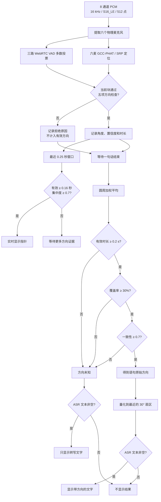
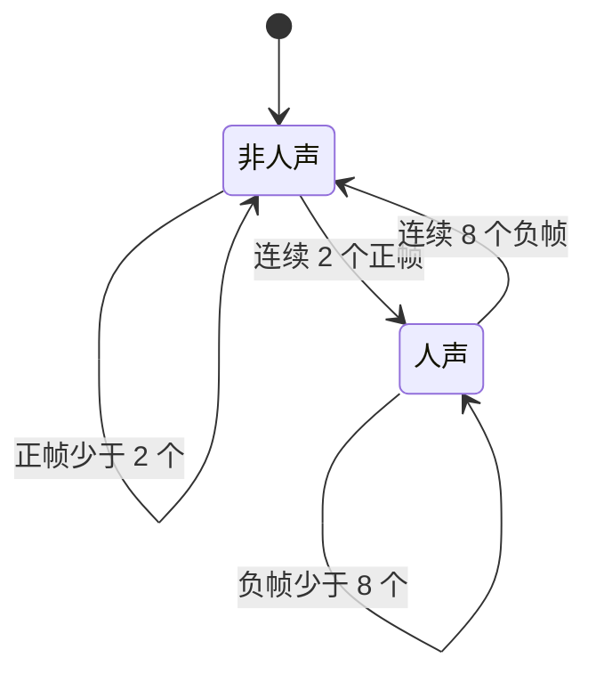
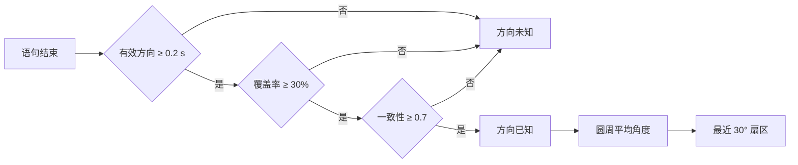
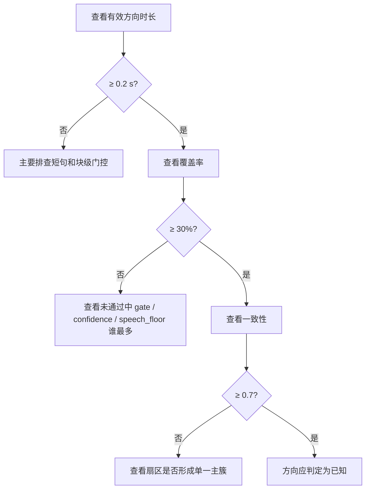

# 当前声源方向判定算法

> 适用代码：VA60X-GL 当前工作区
> 文档日期：2026-10-26  
> 目的：说明实时指针和转写条目的方向如何判定，以及各日志指标如何对应代码。

## 1. 最终结论先行

当前应用有两条独立的方向结果，均先经过音频块级筛选：

1. **音频块级筛选**：每个约 32 ms 的块必须同时通过人声、语音频带、信噪比、基础电平和定位置信度检查，才能成为有效方向证据。
2. **实时指针**：最近 0.25 秒的有效人声块经过圆周平均；累计 0.16 秒且集中程度达到 0.7 后指向。一段语音内允许 0.45 秒 VAD 掉票，锁定首次方向附近 ±55°。
3. **转写方向**：一句话结束后，全部有效方向按时长和置信度做圆周加权平均，并检查有效时长、覆盖率和一致性。

实时指针不等待 ASR。ASR 返回的文字独立显示；该段方向未通过时，界面只显示转写文字，终端默认输出详细诊断。配置 `direction_unknown_log_enabled: false` 可关闭该终端日志。



## 2. 输入与麦克风映射

采集必须保持八通道。定位只从中选取六个物理麦克风：

| 物理麦克风 | 硬件通道 | 程序索引 | 用途 |
|---|---:|---:|---|
| MIC_1 | 1 | 0 | 定位、VAD、默认 ASR |
| MIC_2 | 5 | 4 | 定位 |
| MIC_4 | 6 | 5 | 定位、VAD |
| MIC_5 | 2 | 1 | 定位 |
| MIC_6 | 3 | 2 | 定位、VAD |
| MIC_8 | 4 | 3 | 定位 |
| 空通道 | 7 | 6 | 不使用 |
| 回采通道 | 8 | 7 | 不使用 |

当前主要输入参数：

| 参数 | 当前值 | 含义 |
|---|---:|---|
| `rate` | 16000 Hz | 采样率 |
| `channels` | 8 | 原始采集通道数 |
| `frame_size` | 512 | 每个定位块的采样点数，约 32 ms |
| `mic_channels` | `[0,4,5,1,2,3]` | 六麦物理顺序 |
| `radius_m` | 0.035 m | 假定阵列半径，目前仍是估算值 |

## 3. 人声状态判定

VAD 从六麦中选择三个分散位置：MIC_1、MIC_4、MIC_6。每一路使用 20 ms WebRTC VAD 帧，各自带进入和退出迟滞：

- 连续 2 个正帧后进入人声状态，约 40 ms；
- 连续 8 个负帧后退出人声状态，约 160 ms；
- 三路中至少两路处于人声状态，数组级 `speech` 才为 `true`；
- `vad_mode = 3`，数值越大越严格。

分句器和方向筛选器现在都使用同一个经过迟滞的 `speech` 状态，因此语句人声时长与方向覆盖率采用同一口径。



## 4. 每个音频块如何计算方向

### 4.1 基础定位

六麦组成 15 个麦克风对。每个 512 点音频块经过以下处理：

1. 按 `mic_channels` 提取六路信号并去直流；
2. 使用 Hann 窗和 1024 点 FFT；
3. 只保留 250–4000 Hz；
4. 对 15 个麦克风对计算 GCC-PHAT；
5. 扫描 0–358°，步长 2°；
6. 按六麦圆环几何查找各方向的理论时延并累加 SRP 得分；
7. 得分最高的角度作为该块原始方向；
8. 最后应用 `mirror` 和 `angle_offset_deg`。

输入低于 -75 dBFS，或六麦中少于四路有有效信号时，该块不进行完整定位。

### 4.2 `confidence` 的含义

`confidence` 由两部分相乘得到：

```text
confidence = coherence_score × peak_sharpness
```

- `coherence_score`：15 个麦克风对在候选方向上的一致程度；
- `peak_sharpness`：相关峰相对背景是否足够突出；
- 结果裁剪到 0–1；
- `confidence >= 0.2` 才认为该块有可用方向。

这个值是经验评分，不是“方向正确概率”。

### 4.3 噪声模型

只有明确处于非人声状态、并且当前 VAD 帧中没有正判定时，系统才学习背景噪声频谱。累计至少三个噪声块后，风扇、嗡声等稳定频点会在定位阶段降低权重。

实时界面的“适应当前噪音”按钮会重置噪声频谱估计，并重新采集约 2 秒无语音的环境声；检测到语音时暂停计数。完成后，该频谱估计用于稳定噪声频点降权和 SNR 判断，之后仍会在静音段缓慢跟随环境变化。校准时应保持安静，且它不能消除混响或让强噪声中的语音凭空变清晰。

噪声模型不会消除房间反射，也不能解决前后方向混淆。

## 5. 音频块成为方向证据的五个条件

一个块只有同时满足以下条件，才设置 `sentence_direction_valid = true`：

```text
speech == true
AND analysis_dbfs >= -58 dBFS
AND (噪声模型未校准 OR snr_db >= 0 dB)
AND dbfs >= -40 dBFS
AND confidence >= 0.2
```

| 检查 | 当前门限 | 失败日志代码 | 作用 |
|---|---:|---|---|
| 三路 VAD 多数投票 | 至少 2/3 路 | `vad` | 确认当前处于人声状态 |
| 语音频带电平 | `-58 dBFS` | `speech_floor` | 避免极弱的 250–4000 Hz 信号参与 |
| 信噪比 | 已校准时至少 `0 dB` | `snr` | 避免语音频带不高于噪声底 |
| 六麦综合电平 | `-40 dBFS` | `gate_dbfs` | 语句方向证据的基础硬门限 |
| 定位评分 | `0.2` | `confidence` | 排除相干性或相关峰不足的方向 |

同一个块可能同时失败多项，因此日志里的各个“未通过时长”可能重叠，不能相加后解释为总失败时长。

实时界面还有一个较宽松的自适应活动门限，它只影响实时活动状态，不替代语句方向所用的 `-40 dBFS` 硬门限。

## 6. 分句与 ASR

分句器使用与方向筛选相同的 `speech` 状态：

| 参数 | 当前值 | 行为 |
|---|---:|---|
| `asr_pre_roll_seconds` | 0.3 s | 保留开口前的音频供 ASR 使用 |
| `asr_silence_seconds` | 0.6 s | 连续静音达到该时长后结束一句 |
| `asr_min_speech_seconds` | 0.24 s | 人声少于该时长时不提交识别 |
| `asr_max_seconds` | 5 s | 超长语句切段；上限可配置为 30 s |

预留音频和非人声静音可以进入 ASR 音频，但不计入语句方向证据和方向覆盖率分母。

## 7. 语句级方向汇总

### 7.1 圆周加权平均

每个有效块的权重为：

```text
weight_i = 有效采样数_i × confidence_i
```

对每个角度 `θᵢ` 计算：

```text
S = Σ weight_i × sin(θ_i)
C = Σ weight_i × cos(θ_i)
mean_angle = atan2(S, C) mod 360°
consistency = sqrt(S² + C²) / Σ weight_i
```

圆周平均能正确处理 359° 和 1°，两者平均仍接近 0°，不会错误地变成 180°。

### 7.2 覆盖率

```text
coverage = 有效方向采样数 / speech == true 的采样数
```

例如一句话的人声时长为 2.0 秒，其中只有 0.8 秒通过五项块级检查：

```text
coverage = 0.8 / 2.0 = 40%
```

### 7.3 一致性

`consistency` 的范围为 0–1：

- 接近 1：有效角度集中在同一方向附近；
- 接近 0：角度分散在圆周各处，或相反方向互相抵消；
- 当前必须达到 `0.7`。

一致性计算使用每个块的原始 2° 角度和置信度权重，不使用日志里的 30° 扇区统计。

## 8. 最终“方向已知”判定

语句必须同时满足：

| 条件 | 当前门限 | 失败原因 |
|---|---:|---|
| 有效方向时长 | 至少 `0.2 s` | `insufficient_valid_duration` |
| 有效方向覆盖率 | 至少 `30%` | `insufficient_coverage` |
| 圆周一致性 | 至少 `0.7` | `low_consistency` |



多个失败原因可以同时出现。例如覆盖率 22%、一致性 0.5 时，日志会同时包含“方向覆盖不足”和“方向一致性不足”。

## 9. 30° 扇区与显示

方向已知后，原始平均角度量化到最近的 30° 扇区：

```text
68°  → 60° ±15°
352° →  0° ±15°
```

当前 UI 行为：

| ASR 结果 | 方向结果 | UI 行为 | 终端行为 |
|---|---|---|---|
| 非空 | 已知 | 新增带扇区的转写；指针继续实时跟踪 | 无方向未知日志 |
| 非空 | 未知 | 新增纯转写文字；指针继续实时跟踪 | 开关开启时打印方向未知详细诊断 |
| 空 | 任意 | 不新增转写；指针继续实时跟踪 | 无方向未知日志 |

指针使用最近 0.25 秒有效人声方向的圆周平均，累计至少 0.16 秒有效音频时显示；短暂 VAD 掉票 0.45 秒内会保留最近稳定方向，确认语音结束后再保持 0.4 秒。一段语音内只接纳首次方向附近 ±55° 的后续定位帧，已校准的低信噪比帧不推动指针。转写扇区是该段语音的历史方向，与当前指针可能不同。`hold_seconds = 0.55` 只控制无 VAD 或演示模式的原有跟踪器。

## 10. 扇区分布日志的含义

未知方向日志会把有效方向按 30° 扇区统计，例如：

```text
扇区：270° 0.74s/96%、180° 0.03s/4%
```

含义是：全部通过块级五项检查的方向中，96% 的有效时长落在 270° 扇区，4% 落在 180° 扇区。

该分布当前只用于诊断，**不参与最终方向判定**。最终判定仍使用全部有效块的原始角度做圆周平均。

## 11. 当前没有实现主方向聚类

目前算法不会先寻找主方向簇，也不会排除远离主方向的离群角度。因此少量强反射方向可能拉低全句一致性，造成 `low_consistency`。

如果后续加入主方向聚类，建议至少包含以下保护条件：

1. 在圆周角度上聚类，正确处理 359°/1°；
2. 使用 `时长 × confidence` 作为聚类权重；
3. 要求主簇权重占比达到明确门限；
4. 主簇自身仍需满足最小时长和一致性；
5. 保留全句覆盖率检查，防止只凭很短的稳定片段给出方向；
6. 日志同时保留全局分布和主簇指标，便于判断是否误选反射方向。

## 12. 如何判断当前算法是否生效

可以按下面顺序看一条日志：



实用判断方式：

- `gate_dbfs` 时间较长：说话电平相对硬门限偏低；
- `confidence` 时间较长：麦克风对相干性、几何、反射或信号质量可能有问题；
- 覆盖率达标、一致性低：有效方向在句内分散；
- 一个扇区占 80% 以上但一致性仍低：可能有少量远距离离群角度，适合评估主方向聚类；
- 最大扇区不足 50%，且多个远距离扇区都有较大占比：当前没有可靠主方向，应先排查反射、多人声、声源移动、通道映射和阵列几何；
- 固定声源反复出现相差约 180° 的主扇区：重点检查前后方向混淆、强反射和麦克风实际位置。

## 13. 已知限制

1. `radius_m = 0.035` 是估算值，几何误差会影响理论时延和角度稳定性。
2. `confidence` 是经验评分，没有用带真实角度标签的数据做概率校准。
3. 房间反射、桌面反射、播放人声和多人同时说话可能通过 VAD。
4. 当前所有有效角度一起参与圆周平均，尚未实现主方向聚类和离群值抑制。
5. 30° 扇区分布按有效时长统计，而最终圆周平均还会乘以 `confidence`，两者占比不会完全等价。
6. `angle_offset_deg` 和 `mirror` 只能校正整体旋转与镜像，不能修复错误的麦克风几何或通道顺序。

